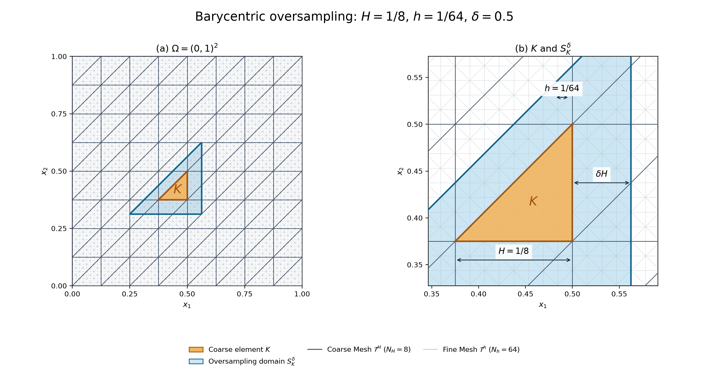



## Multiscale Elliptic PDEs

Let $\Omega\subset\mathbb{R}^{d}$ be a bounded Lipschitz domain. We consider

$$
    \begin{cases}
       -\nabla \cdot a^{\varepsilon} \nabla u^{\varepsilon}
           = f & \text{in } \Omega, \\
       u^{\varepsilon}  = 0 & \text{on } \partial\Omega,
    \end{cases}
$$

where

- $a^{\varepsilon}: \Omega \to \mathbb{R}^{d\times d}$ characterizes a non-homogeneous medium,
- $\varepsilon \ll \lvert\Omega\rvert=O(1)$ characterizes the size of the microscopic scale.

## Implementation {#msfem-implementation}

### Algorithm {#algorithm}

::::::::::::::::::: {.algorithm aria-label="MsFEM pseudocode"}
::: {.algorithm-line .algorithm-phase}
**Initial**
:::

::: {.algorithm-line .indent-1}
**Construct** [`CoarseMesh`](#coarse-mesh) $\mathcal{T}^H$ and [`CoarseSpace`](#coarse-function-space) $V^H$
:::

::: {.algorithm-line .indent-1}
**Construct** [`FineMesh`](#fine-mesh) $\mathcal{T}^h$ and [`FineSpace`](#fine-function-space) $V^h$
:::

::: {.algorithm-line .indent-1}
**Choose** [`CorrectorType`](#corrector-types) $\alpha\in\{\mathrm{ell},\mathrm{par},\mathrm{mod}\}$ **and parameters.**
:::

::: {.algorithm-line .algorithm-phase}
**Offline**
:::

::: {.algorithm-line .indent-1}
**for each coarse element** $K\in\mathcal{T}^H$ **do**
:::

::: {.algorithm-line .indent-2}
$(S^\delta_K,V^h(S^\delta_K))\gets$ [`Oversampling`](#oversampling)$(K,\delta)$
:::

::: {.algorithm-line .indent-2}
$\{\chi^{h,\alpha}_{j,K}\}_{j=1}^d\gets$ [`LocalCorrectors`](#local-correctors)$(a^\varepsilon,V^h(S^\delta_K);\alpha,T,N_t)$
:::

::: {.algorithm-line .indent-2}
$\{\widetilde{\Phi}^H_{l,K}\}_{l=1}^{d+1}\gets$ [`AffineExtension`](#affine-extension)$(K,V^H,V^h(S^\delta_K))$
:::

::: {.algorithm-line .indent-2}
$\{\Phi^{\mathrm{MsFEM},\alpha}_{l,K}\}_{l=1}^{d+1}\gets$ [`MultiscaleBasis`](#multiscale-basis)$(\{\widetilde{\Phi}^H_{l,K}\},\{\chi^{h,\alpha}_{j,K}\})$
:::

::: {.algorithm-line .indent-2}
$(A_K,\mathbf b_K)\gets$ [`LocalAssemble`](#local-assemble)$(a^\varepsilon,f,\{\Phi^{\mathrm{MsFEM},\alpha}_{l,K}\},\{\widetilde{\Phi}^H_{l,K}\})$
:::

::: {.algorithm-line .indent-1}
**end for**
:::

::: {.algorithm-line .indent-1}
$(A^H,\mathbf b^H)\gets$ [`GlobalAssemble`](#global-assemble)$(\{(A_K,\mathbf b_K)\},V^H)$
:::

::: {.algorithm-line .algorithm-phase}
**Online**
:::

::: {.algorithm-line .indent-1}
Solve $A^H\mathbf U=\mathbf b^H$.
:::

::: {.algorithm-line .indent-1}
Reconstruct $\left.u^{\mathrm{MsFEM},\alpha}\right|_K =
\sum_{l=1}^{d+1}U_{l,K}
\left.\Phi^{\mathrm{MsFEM},\alpha}_{l,K}\right|_K$ for each $K\in\mathcal T^H$.
:::
:::::::::::::::::::

### Meshes and Function Spaces {#meshes-and-function-spaces}

#### `CoarseMesh` {#coarse-mesh}

$\mathcal{T}^H$ denotes a coarse triangulation of $\Omega$ into triangles (for $d=2$) or tetrahedra (for $d=3$).

For the structured rectangular grid, $H=1/N_H$ is the coordinate grid spacing.

#### `FineMesh` {#fine-mesh}

$\mathcal{T}^h$ denotes the fine triangulation obtained from $\mathcal{T}^H$ by uniform refinement.

The resolution is labelled by $h=1/N_h$.

#### `LagrangeSpace` {#lagrange-space}

$$
{P_1}(\mathcal{T}) = \{v\in C^0(\Omega) | \forall K \in \mathcal{T}, v|_K \text{ is a polynomial of total degree }\leq 1\} .
$$

#### `FineSpace` {#fine-function-space}

$$
V^h := P_1(\mathcal{T}^h).
$$

Here $P_1$ is the [Lagrange polynomial space](#lagrange-space).

#### `CoarseSpace` {#coarse-function-space}

$$
V^H := P_1(\mathcal{T}^H)\subset V^h.
$$

Here $P_1$ is the [Lagrange polynomial space](#lagrange-space).

### Oversampling Strategies {#oversampling-strategies}

#### `Oversampling` {#oversampling}

**Input:** $K\in\mathcal T^H$ and $\delta\geq0$.

**Output:** $S^\delta_K$ and $V^h(S^\delta_K)$.

Let $\lambda_i^K$ be the affinely extended barycentric coordinates of $K$, and $\mathcal V(\tau)$ the vertices of a fine triangle $\tau$. Define

$$
\mathcal T^h(S^\delta_K) :=\left\{\tau\in\mathcal T^h: \min_{v\in\mathcal V(\tau)}\lambda_i^K(v)\geq-\delta, \quad i=0,1,2\right\},
$$

$$
S^\delta_K :=\operatorname{int}\bigcup_{\tau\in\mathcal T^h(S^\delta_K)}\overline\tau.
$$

The local fine-scale spaces are

$$
V^h(S^\delta_K):=P_1(\mathcal T^h(S^\delta_K)),\quad \mathring V^h(S^\delta_K):=V^h(S^\delta_K)\cap H^1_0(S^\delta_K).
$$

{width="100%" fig-alt="Oversampling domain, coarse element, and coarse/fine meshes"}

### Local Correctors {#local-correctors}

**Input:** coefficient $a^\varepsilon$, the local fine-scale space $V^h(S^\delta_K)$, a corrector type $\alpha$, and the parameters required by that type.

**Output:** local correctors $\{\chi^{h,\alpha}_{j,K}\}_{j=1}^d$.

#### `CorrectorType` {#corrector-types}

| $\alpha$ | Method | Required parameters |
|------------------------|------------------------|------------------------|
| $\mathrm{ell}$ | [Elliptic correctors](#elliptic-correctors) | None (infinite-time limit on a fixed patch) |
| $\mathrm{par}$ | [Parabolic correctors](#parabolic-correctors) | $T>0$, $N_t\geq1$ |
| $\mathrm{mod}$ | [Modified elliptic correctors](#modified-correctors) | $T>0$ |

#### `EllipticCorrectors` {#elliptic-correctors}

**1. Continuous problem**

For each $j=1,\ldots,d$, define

$$
g_j:=\nabla\cdot(a^\varepsilon e_j).
$$

The continuous corrector $\chi^{\mathrm{ell}}_{j,K}$ solves

$$
\begin{cases}
-\nabla\cdot(a^\varepsilon\nabla\chi^{\mathrm{ell}}_{j,K})=g_j
&\text{in }S^\delta_K,\\
\chi^{\mathrm{ell}}_{j,K}=0&\text{on }\partial S^\delta_K.
\end{cases}
$$

**2. Discrete variational problem**

Find $\chi^{h,\mathrm{ell}}_{j,K}\in\mathring V^h(S^\delta_K)$ such that

$$
\int_{S^\delta_K} a^\varepsilon\nabla\chi^{h,\mathrm{ell}}_{j,K}\cdot\nabla\phi^h\,\mathrm{d}x =-\int_{S^\delta_K}a^\varepsilon e_j\cdot\nabla\phi^h\,\mathrm{d}x,\qquad\forall\phi^h\in\mathring V^h(S^\delta_K).
$$

#### `ParabolicCorrectors` {#parabolic-correctors}

**1. Continuous problem**

Solve

$$
\begin{cases}
\partial_t v_j-\nabla\cdot(a^\varepsilon\nabla v_j)=0
&\text{in }S^\delta_K\times(0,T],\\
v_j=0&\text{on }\partial S^\delta_K\times(0,T],\\
v_j(0)=g_j&\text{in }S^\delta_K,
\end{cases}
$$

then integrate in time:

$$
\chi^{\mathrm{par}}_{j,K}(T):=\int_0^T v_j(t)\,\mathrm{d}t.
$$

**2. Discrete variational problem**

Let $\Delta t=T/N_t$ and $t_n=n\Delta t$.

**(i) Initial value.** Find $v^h_{j,0}\in\mathring V^h(S^\delta_K)$ such that

$$
\int_{S^\delta_K}v^h_{j,0}\phi^h\,\mathrm{d}x =-\int_{S^\delta_K}a^\varepsilon e_j\cdot\nabla\phi^h\,\mathrm{d}x, \quad\forall\phi^h\in\mathring V^h(S^\delta_K).
$$

**(ii) Backward Euler.** For $n=1,\ldots,N_t$, find $v^h_{j,n}\in\mathring V^h(S^\delta_K)$ such that

$$
\int_{S^\delta_K}v^h_{j,n}\phi^h\,\mathrm{d}x +\Delta t\int_{S^\delta_K}a^\varepsilon\nabla v^h_{j,n}\cdot\nabla\phi^h\,\mathrm{d}x =\int_{S^\delta_K}v^h_{j,n-1}\phi^h\,\mathrm{d}x,\quad\forall\phi^h\in\mathring V^h(S^\delta_K).
$$

**(iii) Trapezoidal rule.** Compute

$$
\chi^{h,\mathrm{par}}_{j,K}(T) :=\Delta t\left( \frac12v^h_{j,0} +\sum_{n=1}^{N_t-1}v^h_{j,n} +\frac12v^h_{j,N_t} \right).
$$

#### `ModifiedCorrectors` {#modified-correctors}

**1. Continuous problem**

Let $\mathcal A=-\nabla\cdot(a^\varepsilon\nabla)$ be the diffusion operator on $S^\delta_K$ with homogeneous Dirichlet boundary conditions. The modified corrector solves

$$
\begin{cases}
\mathcal A\chi^{\mathrm{mod}}_{j,K}(T)
=g_j-e^{-T\mathcal A}g_j
&\text{in }S^\delta_K,\\
\chi^{\mathrm{mod}}_{j,K}(T)=0&\text{on }\partial S^\delta_K.
\end{cases}
$$

Here $e^{-T\mathcal A}g_j=v_j(T)$ is the solution of the [parabolic problem](#parabolic-correctors) at time $T$.

**2. Discrete operator**

Define $\mathcal A^h:\mathring V^h(S^\delta_K)\to\mathring V^h(S^\delta_K)$ by

$$
\int_{S^\delta_K}(\mathcal A^h\psi^h)\phi^h\,\mathrm{d}x =\int_{S^\delta_K}a^\varepsilon\nabla\psi^h\cdot\nabla\phi^h\,\mathrm{d}x, \quad\forall\psi^h,\phi^h\in\mathring V^h(S^\delta_K).
$$

With $v^h_{j,0}$ defined in the [parabolic formulation](#parabolic-correctors), the discrete corrector satisfies

$$
\mathcal A^h\chi^{h,\mathrm{mod}}_{j,K}(T)=(I-e^{-T\mathcal A^h})v^h_{j,0}.
$$

Equivalently, it is the time integral of the discrete diffusion solution:

$$
\chi^{h,\mathrm{mod}}_{j,K}(T) =\int_0^T e^{-t\mathcal A^h}v^h_{j,0}\,\mathrm{d}t =T\varphi_1(-T\mathcal A^h)v^h_{j,0},
$$

where

$$
\varphi_1(z)=\frac{e^z-1}{z},\quad\varphi_1(0)=1.
$$

See [SLEPc evaluation](#slepc-evaluation) in the appendix.

### Affine Extension {#affine-extension}

**Input:** coarse element $K$, coarse space $V^H$, and local fine space $V^h(S^\delta_K)$.

**Output:** affine extensions $\{\widetilde{\Phi}^H_{l,K}\}_{l=1}^{d+1}$ of the local coarse nodal basis from $K$ to $S^\delta_K$. Each $\widetilde{\Phi}^H_{l,K}$ is affine on the patch, and its restriction to $K$ is the corresponding local nodal basis function of $P_1(K)$.

Let $x_K\in\operatorname{int}K$ be an arbitrary point, for example the barycenter, and let $\Phi^H_{l,K}$ be the local coarse nodal basis function on $K$. Its affine extension is

$$
\widetilde{\Phi}^H_{l,K}(x) :=(x-x_K)\cdot\nabla\Phi^H_{l,K}(x_K)+\Phi^H_{l,K}(x_K).
$$

This formula defines the extension for all $x\in S^\delta_K$. Since $\Phi^H_{l,K}$ is affine on $K$, the extension is independent of the chosen interior point $x_K$ and agrees with $\Phi^H_{l,K}$ on $K$.

### Multiscale Basis {#multiscale-basis}

**Input:** affine extensions $\{\widetilde{\Phi}^H_{l,K}\}_{l=1}^{d+1}$ and directional correctors $\{\chi^{h,\alpha}_{j,K}\}_{j=1}^d$ on $S^\delta_K$.

**Output:** local multiscale basis functions $\{\Phi^{\mathrm{MsFEM},\alpha}_{l,K}\}_{l=1}^{d+1}$.

For a simplicial element $K$, define on the patch $S^\delta_K$

$$
\Phi^{\mathrm{MsFEM},\alpha}_{l,K} = \widetilde{\Phi}^H_{l,K} + \sum_{j=1}^d \chi^{h,\alpha}_{j,K}\,\partial_{x_j}\widetilde{\Phi}^H_{l,K}.
$$

The restrictions $\Phi^{\mathrm{MsFEM},\alpha}_{l,K}|_K$ are used for local assembly and reconstruction of $u^{\mathrm{MsFEM},\alpha}$.

### Local Assemble {#local-assemble}

For the Petrov--Galerkin assembly used in the algorithm, compute the local contributions on $K$:

$$
(A_K)_{il} =\int_K a^\varepsilon\nabla\Phi^{\mathrm{MsFEM},\alpha}_{l,K}|_K \cdot \nabla {\Phi}^H_{i,K}\,\mathrm{d}x,
$$

$$
(\mathbf b_K)_i =\int_K f{\Phi}^H_{i,K}\,\mathrm{d}x.
$$

### Global Assemble {#global-assemble}

**Input:** local contributions $\{(A_K,\mathbf b_K)\}_{K\in\mathcal{T}^H}$ and the coarse local-to-global degree-of-freedom map associated with $V^H$.

**Output:** the global coarse matrix $A^H$ and load vector $\mathbf b^H$.

Accumulate the local contributions using the coarse degree-of-freedom map, then impose the homogeneous Dirichlet boundary conditions. The resulting system is $A^H\mathbf U=\mathbf b^H$.

The corresponding global Petrov--Galerkin problem is to find coarse coefficients $\mathbf U$ associated with $\mathring V^H:=V^H\cap H^1_0(\Omega)$ whose multiscale reconstruction

$$
\left.u^{\mathrm{MsFEM},\alpha}\right|_K=\sum_{l=1}^{d+1}U_{l,K}\left.\Phi^{\mathrm{MsFEM},\alpha}_{l,K}\right|_K,\qquad K\in\mathcal T^H,
$$

satisfies

$$
\sum_{K\in\mathcal T^H}\int_K a^\varepsilon\nabla u^{\mathrm{MsFEM},\alpha}\cdot\nabla \Phi^H\,\mathrm{d}x=\int_\Omega f \Phi^H\,\mathrm{d}x,\qquad\forall \Phi^H\in\mathring V^H.
$$

Here $U_{l,K}$ are the entries of $\mathbf U$ associated with the coarse nodes of $K$. The gradient of $u^{\mathrm{MsFEM},\alpha}$ is taken elementwise, since the reconstruction may be discontinuous across coarse-element interfaces.

For the oversampling framework, see Henning and Peterseim, [*Oversampling for the Multiscale Finite Element Method*](https://doi.org/10.1137/120900332).

## Numerical Results

### Periodic Coefficient

#### Problem Setting

Let $\Omega=(0,1)^2$ and $\varepsilon=0.05$. We define

$$
u^\varepsilon(x)=\sin(2\pi x_1)\sin(2\pi x_2)+\frac{\varepsilon}{2}\cos(2\pi x_1)\sin(2\pi x_2)\sin\frac{2\pi x_1}{\varepsilon}.
$$

$$
a^\varepsilon(x)=a(x/\varepsilon),\qquad a(y)=\frac{1}{8\pi^2}\begin{pmatrix}\dfrac{2}{2+\cos(2\pi y_1)}&0\\0&1+\dfrac12\cos(2\pi y_1)\end{pmatrix}.
$$

The source is manufactured from this same coefficient and solution, exactly as in `source`:

$$
f^\varepsilon(x):=-\nabla\cdot\big(a^\varepsilon(x)\nabla u^\varepsilon(x)\big)=-\partial_{x_1}\big(a^\varepsilon_{11}\partial_{x_1}u^\varepsilon\big)-\partial_{x_2}\big(a^\varepsilon_{22}\partial_{x_2}u^\varepsilon\big).
$$

Thus the periodic experiment solves

$$
\begin{cases}
-\nabla\cdot(a^\varepsilon\nabla u^\varepsilon)=f^\varepsilon&\text{in }\Omega,\\
u^\varepsilon=0&\text{on }\partial\Omega.
\end{cases}
$$

This is the manufactured benchmark in Henning and Peterseim, [*Oversampling for the Multiscale Finite Element Method*, Section 5, p. 1172](https://doi.org/10.1137/120900332).

#### Homogenization Results

- **Homogenized limit.** Periodic homogenization gives convergence of the solution and flux as $\varepsilon\to0$.

  $$
  \varepsilon^{-1}\in\mathbb N,\qquad \varepsilon\to0,\qquad f^\varepsilon\to f^0\ \text{in }H^{-1}(\Omega).
  $$

  $$
  u^\varepsilon\rightharpoonup u^0\ \text{in }H^1_0(\Omega),\qquad u^\varepsilon\to u^0\ \text{in }L^2(\Omega),\qquad a^\varepsilon\nabla u^\varepsilon\rightharpoonup a^0\nabla u^0\ \text{in }[L^2(\Omega)]^2.
  $$

- **Homogenized coefficient.** Average the corrected flux over one periodic cell to define $a^0$.

  $$
  K_\varepsilon:=(0,\varepsilon)^2,\qquad e_i\cdot a^0e_j:=\frac{1}{|K_\varepsilon|}\int_{K_\varepsilon}e_i\cdot a^\varepsilon(x)\big(e_j+\nabla\chi_j^\varepsilon(x)\big)\,\mathrm{d}x,\qquad i,j=1,2.
  $$

- **Homogenized solution.** Solve the constant-coefficient limit problem for $u^0$.

  $$
  \begin{cases}
  -\nabla\cdot(a^0\nabla u^0)=f^0&\text{in }\Omega,\\
  u^0=0&\text{on }\partial\Omega.
  \end{cases}
  $$

- **Periodic Cell Problem.** The rescaled correctors $\chi_j^\varepsilon(\mathbf{x}):=\varepsilon\chi_j(\mathbf{x}/\varepsilon)$ satisfy the cell problem

  $$
  \begin{cases}
  -\nabla\cdot a^\varepsilon(e_j+\nabla\chi_j^\varepsilon)=0\quad\text{in }\mathbb R^d,\\[3pt]
  \chi_j^\varepsilon\text{ is $\varepsilon$-periodic},\qquad\displaystyle\fint_{K_\varepsilon}\chi_j^\varepsilon(\mathbf{x})\,\mathrm{d}\mathbf{x}=0.
  \end{cases}
  $$

- **Two-scale expansion.** Add the corrector terms to $u^0$ to approximate $u^\varepsilon$.

  $$
  u^\varepsilon(x)\approx u^0(x)+\sum_{j=1}^2\underbrace{\varepsilon\chi_j(x/\varepsilon)}_{\chi_j^\varepsilon(x)}\,\partial_{x_j}u^0(x).
  $$

#### Exact Periodic Correctors

- $j=1$. Since $a^\varepsilon$ depends only on $x_1$, seek $\chi_1^\varepsilon$ depending only on $x_1$. The cell problem and periodicity give

  $$
  a^\varepsilon_{11}(x_1)(1+\partial_{x_1}\chi_1^\varepsilon)=c_1,\qquad c_1=\left(\frac{1}{\varepsilon}\int_0^\varepsilon a^\varepsilon_{11}(s)^{-1}\,\mathrm{d}s\right)^{-1}=\frac{1}{8\pi^2}.
  $$

  Integrating with zero mean yields

  $$
  \partial_{x_1}\chi_1^\varepsilon=\frac12\cos\frac{2\pi x_1}{\varepsilon},\qquad \chi_1^\varepsilon(x)=\frac{\varepsilon}{4\pi}\sin\frac{2\pi x_1}{\varepsilon}.
  $$

- $j=2$. Since $\nabla\cdot(a^\varepsilon e_2)=\partial_{x_2}a^\varepsilon_{22}=0$, the zero-mean periodic solution is

  $$
  \chi_2^\varepsilon(x)=0.
  $$

Substituting these correctors into the definition of $a^0$ gives

$$
a^0e_1=c_1e_1,\qquad a^0e_2=\left(\frac{1}{\varepsilon}\int_0^\varepsilon a^\varepsilon_{22}(s)\,\mathrm{d}s\right)e_2,\qquad a^0=\frac{1}{8\pi^2}I.
$$

The exact manufactured solution then identifies the homogenized limit and source:

$$
u^0(x)=\sin(2\pi x_1)\sin(2\pi x_2),\qquad f^0=-\nabla\cdot(a^0\nabla u^0)=\sin(2\pi x_1)\sin(2\pi x_2).
$$

For this benchmark, the first-order two-scale expansion is an exact identity:

$$
u^\varepsilon=u^0+\sum_{j=1}^2\chi_j^\varepsilon\partial_{x_j}u^0.
$$

#### Configured Experiments

| Parameter | Example Values |
|------------------------------|------------------------------------------|
| $h$ | $1/64,1/128,$ |
| $\varepsilon$ | $0.05,0.02$ |
| $H$ | $1/2, 1/4, \ldots$ |
| $\delta$ | $0, 0.125, 0.25, \ldots$ |
| $\alpha$ | $\mathrm{ell},\mathrm{par},\mathrm{mod}$ |
| Assembly | `petrov-galerkin`, `galerkin` |
| $T$ for $\mathrm{par},\mathrm{mod}$ | $T=O(\varepsilon^2)$ |

### Error Metrics

All errors are absolute. Let $\mathcal F^{H,\mathrm{int}}$ be the internal coarse edges. For $F=\partial K^+\cap\partial K^-$, fix either orientation and define

$$
[v]_F:=\left.v\right|_{K^+}|_F-\left.v\right|_{K^-}|_F.
$$

#### Corrector

**Errors.** Restrict each patch corrector to its core element $K$ and compare it with the analytic periodic corrector:

$$
e^\alpha_{j,K}:=\left.\chi^{h,\alpha}_{j,K}\right|_K-\left.\chi_j^\varepsilon\right|_K,\qquad j=1,2,\quad K\in\mathcal T^H.
$$

The reference is evaluated directly on the fine cells of $K$, without interpolation or mean alignment. Integrals use quadrature degree 12 and are summed over both directions and all coarse elements:

$$
E^\alpha_{\chi,\lVert\cdot\rVert_{L^2}}:=\left(\sum_{K\in\mathcal T^H}\sum_{j=1}^2\int_K|e^\alpha_{j,K}|^2\,\mathrm{d}x\right)^{1/2},
$$

$$
E^\alpha_{\chi,\lvert\cdot\rvert_{H^1}}:=\left(\sum_{K\in\mathcal T^H}\sum_{j=1}^2\int_K|\nabla e^\alpha_{j,K}|^2\,\mathrm{d}x\right)^{1/2},
$$

$$
E^\alpha_{\chi,\lVert\cdot\rVert_{H^1}}:=\left(\sum_{K\in\mathcal T^H}\sum_{j=1}^2\int_K\big(|e^\alpha_{j,K}|^2+|\nabla e^\alpha_{j,K}|^2\big)\,\mathrm{d}x\right)^{1/2}=\left((E^\alpha_{\chi,\lVert\cdot\rVert_{L^2}})^2+(E^\alpha_{\chi,\lvert\cdot\rvert_{H^1}})^2\right)^{1/2}.
$$

The $H^1$ norms are broken over $\mathcal T^H$ and do not include jumps. The second direction is included even though $\chi_2^\varepsilon=0$.

**Jump.** Compare the traces of the two local correctors directly on their shared coarse edge:

$$
J_\chi^\alpha:=\left(\sum_{F\in\mathcal F^{H,\mathrm{int}}}\sum_{j=1}^2\int_F\left|\left.\chi^{h,\alpha}_{j,K^+}\right|_F-\left.\chi^{h,\alpha}_{j,K^-}\right|_F\right|^2\,\mathrm{d}s\right)^{1/2}.
$$

#### MsFEM Solution

**Errors.** Compare the reconstructed solution with the analytic manufactured solution on each coarse element:

$$
e^\alpha_{u,K}:=\left.u^{\mathrm{MsFEM},\alpha}\right|_K-\left.u^\varepsilon\right|_K.
$$

Evaluating on the fine mesh gives

$$
E^\alpha_{u,\lVert\cdot\rVert_{L^2}}:=\left(\sum_{K\in\mathcal T^H}\int_K|e^\alpha_{u,K}|^2\,\mathrm{d}x\right)^{1/2},
$$

$$
E^\alpha_{u,\lvert\cdot\rvert_{H^1}}:=\left(\sum_{K\in\mathcal T^H}\int_K|\nabla e^\alpha_{u,K}|^2\,\mathrm{d}x\right)^{1/2},
$$

$$
E^\alpha_{u,\lVert\cdot\rVert_{H^1}}:=\left(\sum_{K\in\mathcal T^H}\int_K\big(|e^\alpha_{u,K}|^2+|\nabla e^\alpha_{u,K}|^2\big)\,\mathrm{d}x\right)^{1/2}=\left((E^\alpha_{u,\lVert\cdot\rVert_{L^2}})^2+(E^\alpha_{u,\lvert\cdot\rvert_{H^1}})^2\right)^{1/2}.
$$

Here too, the $H^1$ norms are broken over $\mathcal T^H$ and exclude jumps.

**Jump.** Measure the discontinuity of the reconstructed solution across internal coarse edges:

$$
J_u^\alpha:=\left(\sum_{F\in\mathcal F^{H,\mathrm{int}}}\int_F|[u^{\mathrm{MsFEM},\alpha}]_F|^2\,\mathrm{d}s\right)^{1/2}.
$$

**Standard FEM references.** The conforming $P_1$ solutions $u^H\in V^H\cap H^1_0(\Omega)$ and $u^h\in V^h\cap H^1_0(\Omega)$ solve the same oscillatory PDE with $a^\varepsilon,f^\varepsilon$. Their three errors use the same definitions with $u^H$ or $u^h$ in place of $u^{\mathrm{MsFEM},\alpha}$, compared against $u^\varepsilon$.

## Appendix

### SLEPc Evaluation {#slepc-evaluation}

- **`MFN`** evaluates $T\varphi_1(-T\mathcal A^h)v^h_{j,0}$ using the restarted Krylov/Arnoldi method (`KRYLOV`).
- **`FN`** specifies $T\varphi_1(-Tz)$ using `PHI`, index $1$, and `setScale(-T, T)`.

### CSV Fields {#csv-fields}

| Quantity | CSV column |
|------------------------------------|------------------------------------|
| $E^\alpha_{\chi,\lVert\cdot\rVert_{L^2}}$ | `corrector_l2_error` |
| $E^\alpha_{\chi,\lVert\cdot\rVert_{H^1}}$ | `corrector_h1_error` |
| $E^\alpha_{\chi,\lvert\cdot\rvert_{H^1}}$ | `corrector_h1_semi_error` |
| $J_\chi^\alpha$ | `corrector_jump_l2` |
| $E^\alpha_{u,\lVert\cdot\rVert_{L^2}}$ | `msfem_l2_error` |
| $E^\alpha_{u,\lVert\cdot\rVert_{H^1}}$ | `msfem_h1_error` |
| $E^\alpha_{u,\lvert\cdot\rvert_{H^1}}$ | `msfem_h1_semi_error` |
| $J_u^\alpha$ | `msfem_jump_l2` |
| Standard FEM errors of $u^H$, $u^h$ | `coarse_fem_*_error`, `fine_fem_*_error` |